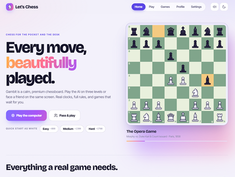

# Let's Chess — Chess, beautifully played

Let's Chess is a premium, mobile-first chess app. You can play an AI on three difficulty levels, or hand the phone to a friend for pass-and-play. Games have real clocks, the complete rules of chess, standard notation, automatic save and resume, and personal statistics.

## Application Preview



## Features

- **Play the computer** on Easy, Medium or Hard as White, Black or Random. The engine runs in a Web Worker.
- **Pass & play** with two named players on one device.
- **Full rules** from [chess.js](https://github.com/jhlywa/chess.js): legal moves, check, checkmate, stalemate, castling, en passant, promotion, threefold repetition, the fifty-move rule and insufficient material.
- **Interactive board** with drag or tap to move, legal-move hints, last-move and check highlights, and animated pieces (undo animates too).
- **Game controls:** undo, flip, draw offer, resign, restart and rematch.
- **SAN move history** with move-by-move review (← / → keys work too) and PGN export.
- **Clocks** from bullet to classical, with increments and low-time warnings.
- **Save & resume:** every unfinished game is saved automatically, remaining time included.
- **Profile & stats:** win rate, streaks, and win/draw/loss per difficulty.
- **Settings:** system/light/dark theme, 4 board finishes, synthesised sounds, animations, coordinates and auto-queen.

## Tech stack

- React 19 + TypeScript + Vite (single-page app)
- React Router 7
- chess.js 1.x for rules and notation
- A custom alpha-beta engine with quiescence and piece-square tables (`src/lib/engine.ts`)
- Plain CSS with custom properties for themes (`src/styles/global.css`)
- Netlify hosting (`netlify.toml`)

## Run locally

```bash
npm install
npm run dev          # Vite dev server
# or, with Netlify emulation:
netlify dev
```

There's no backend yet, so you don't need any environment variables.

## Data

All data currently lives in the browser's local storage, through one module: `src/lib/storage.ts`. Accounts and a database come next. See **PLAN.md**.

## Roadmap

See [PLAN.md](./PLAN.md). Next up:
1. Backend foundation: Netlify Server API and a database schema with `chess_`-prefixed tables (MySQL or Netlify Database, still to be decided).
2. Accounts and authentication.
3. Cloud sync of games, settings and stats, with server-side move validation.
4. Online multiplayer over WebSockets.
